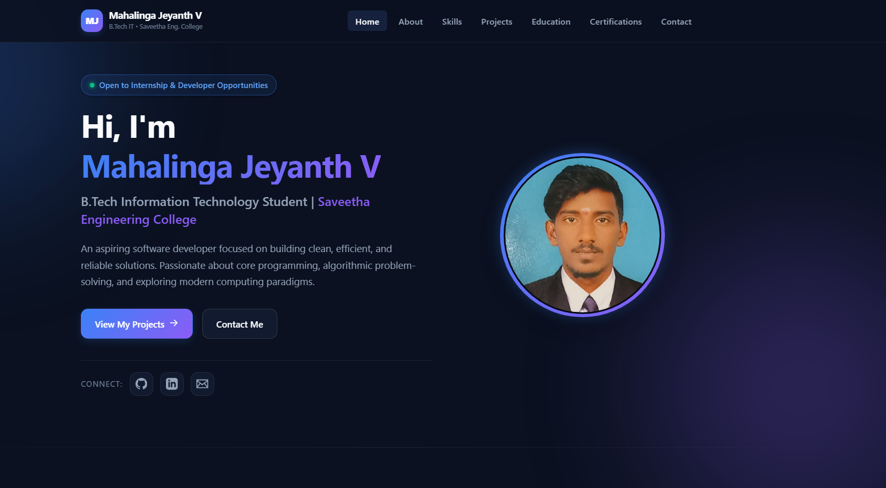
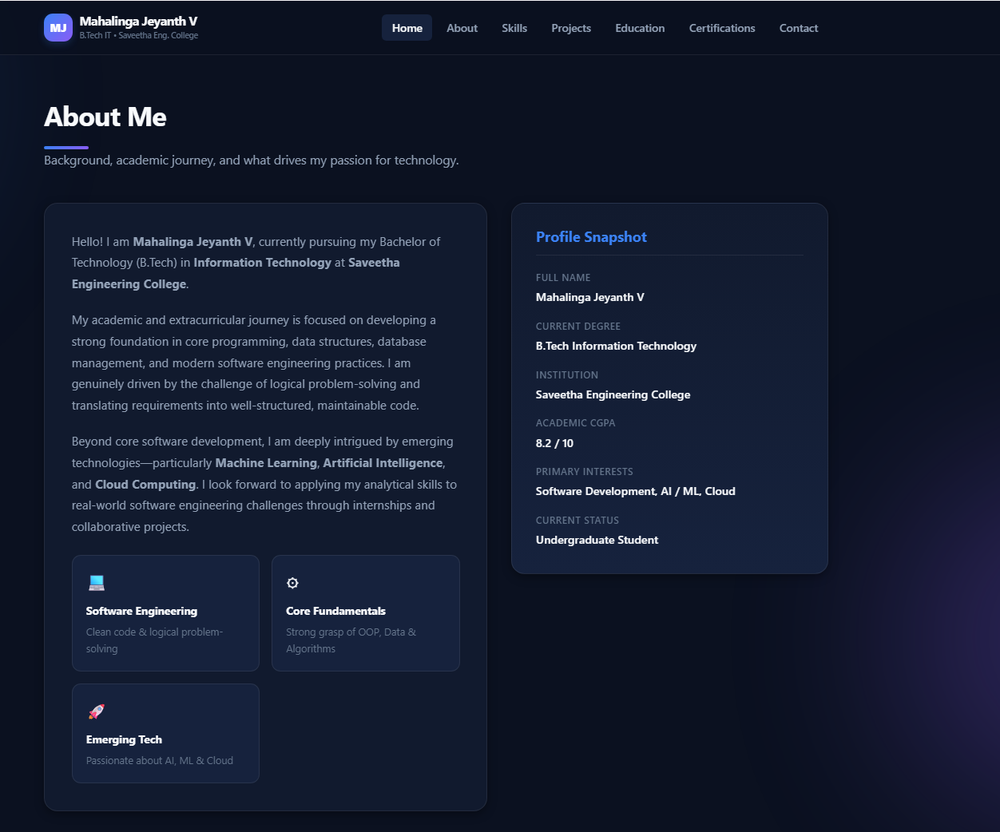
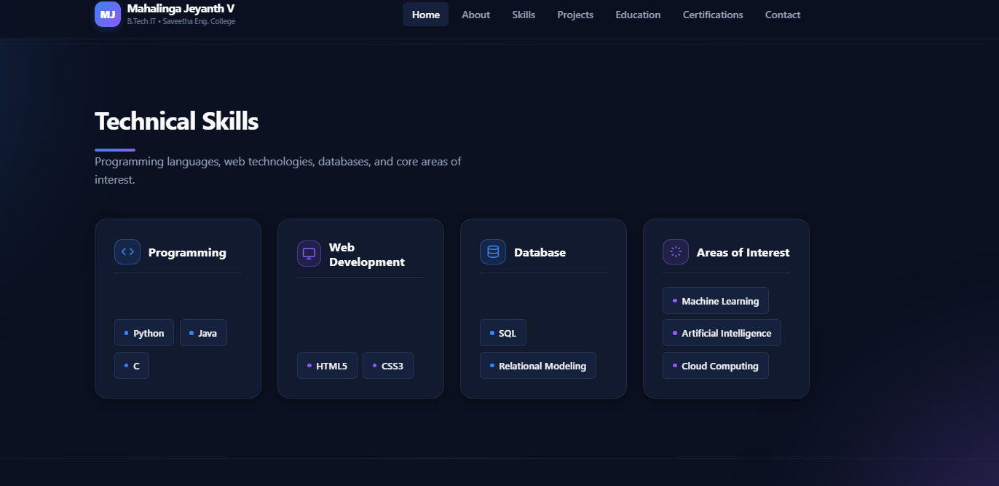
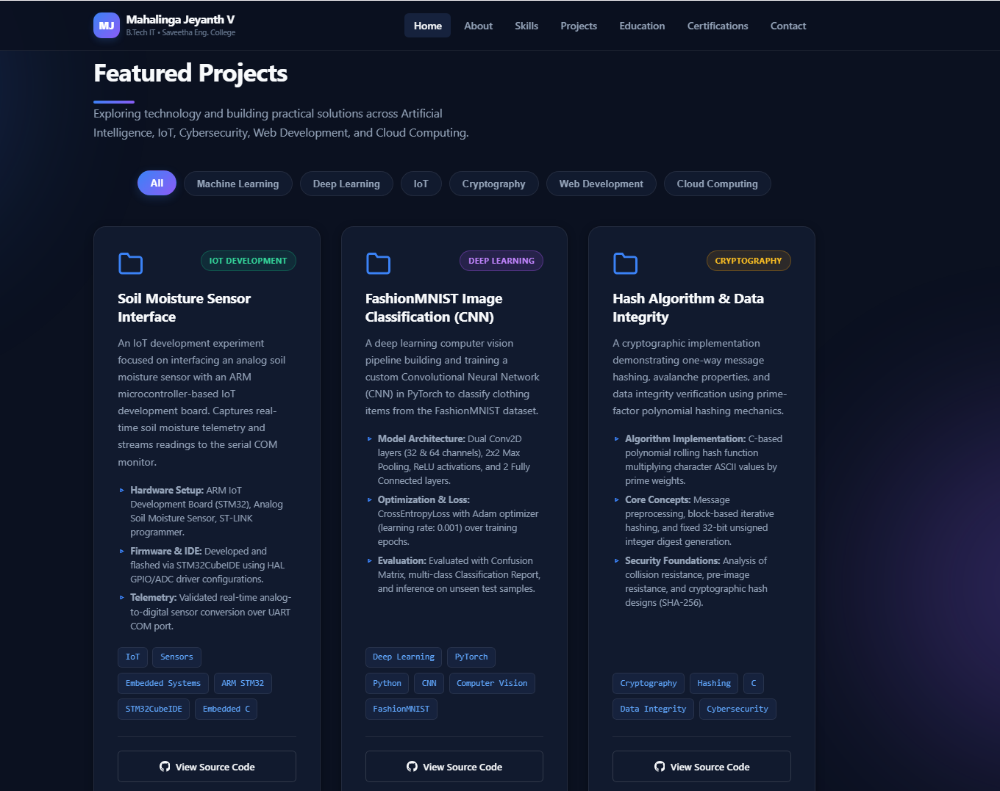
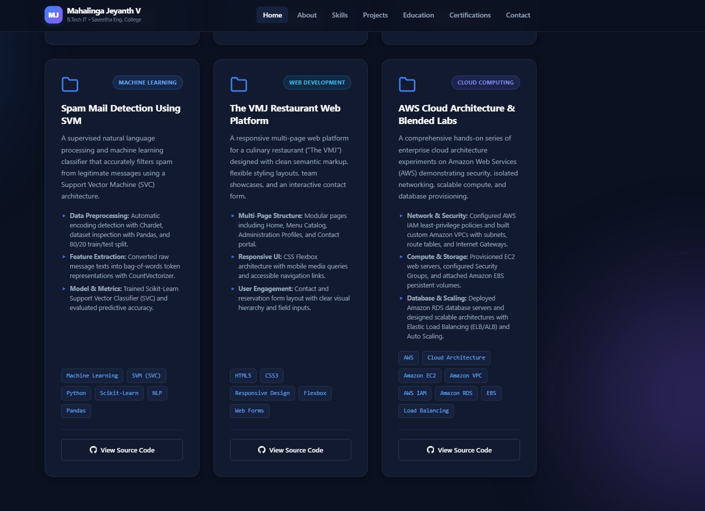
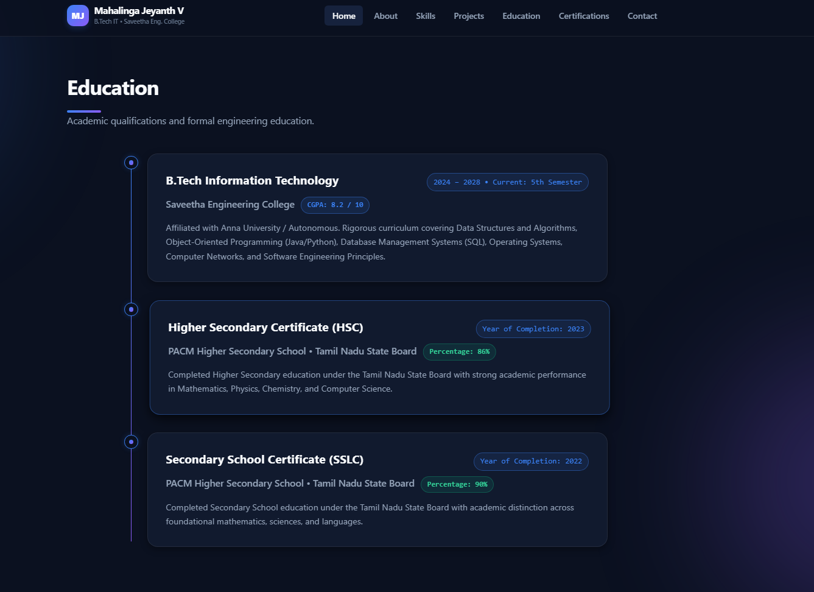
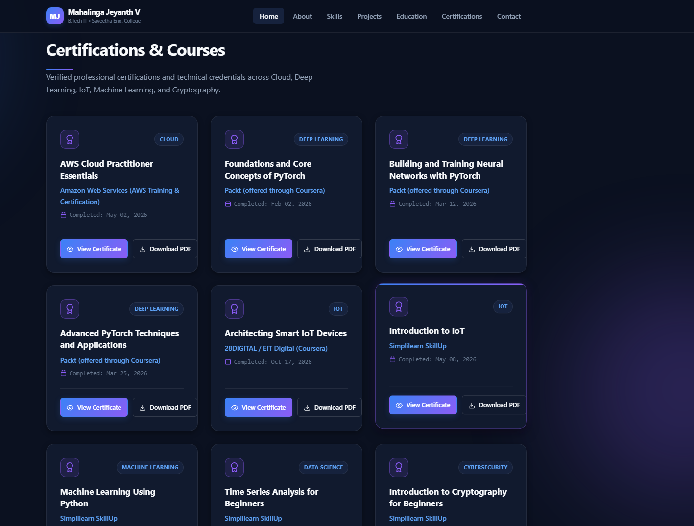
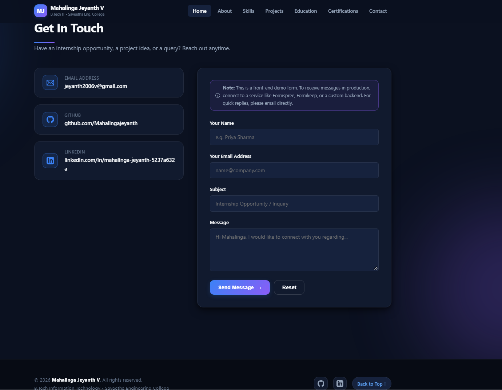

## Ex01 Portfolio
## Date:27-10-2026
## AIM
To create a Portfolio using HTML and CSS.

## ALGORITHM
### STEP 1
Create an HTML file (index.html)

### STEP 2
Create a CSS file (style.css)

### STEP 3
Include a navigation bar with links to different sections.

### STEP 4
Add structured sections for introduction, about, projects, and contact details.

### STEP 5
Define global styles for fonts, colors, and layout.

### STEP 6
Style the header, navigation bar, and sections.

### STEP 7
Use Flexbox or CSS Grid for layout design.

### STEP 8
Add hover effects and transitions for interactivity.

### STEP 9
Add Images and Media.

### STEP 10
Use optimized images for a professional look.

### STEP 11
Open the HTML file in a browser to check layout and functionality.

### STEP 12
Fix styling issues and refine content placement.

### STEP 13
Deploy the Portfolio.

### STEP 14
Upload to GitHub Pages for free hosting.

## PROGRAM
```

<!DOCTYPE html>
<html lang="en">

<head>
    <meta charset="UTF-8">
    <meta name="viewport" content="width=device-width, initial-scale=1.0">

    <meta
        name="description"
        content="Portfolio of Mahalinga Jeyanth V, B.Tech Information Technology student at Saveetha Engineering College."
    >

    <title>Mahalinga Jeyanth V | Portfolio</title>

    <link rel="stylesheet" href="style.css">
</head>

<body>

    <!-- ==================== HEADER ==================== -->
    <header class="site-header">

        <a class="brand" href="#home" aria-label="Mahalinga Jeyanth V home">
            <span class="brand-mark">MJ</span>

            <span>
                <strong>Mahalinga Jeyanth V</strong>
                <small>B.Tech IT · Saveetha Engineering College</small>
            </span>
        </a>

        <button
            class="menu-toggle"
            id="menuToggle"
            aria-label="Toggle navigation"
            aria-expanded="false"
        >
            ☰
        </button>

        <nav class="nav" id="navMenu" aria-label="Main navigation">
            <a href="#home" class="active">Home</a>
            <a href="#about">About</a>
            <a href="#skills">Skills</a>
            <a href="#projects">Projects</a>
            <a href="#education">Education</a>
            <a href="#certifications">Certificates</a>
            <a href="#contact">Contact</a>
        </nav>

    </header>


    <!-- ==================== MAIN CONTENT ==================== -->
    <main>

        <!-- ==================== HOME SECTION ==================== -->
        <section class="hero section" id="home">

            <div class="hero-copy">

                <p class="eyebrow">HELLO, I'M</p>

                <h1>
                    Mahalinga <span>Jeyanth V</span>
                </h1>

                <h2>B.Tech Information Technology Student</h2>

                <p class="hero-text">
                    Interested in building practical solutions across Machine Learning,
                    Deep Learning, IoT, Cryptography, Web Development, and Cloud Computing.
                </p>

                <div class="hero-actions">
                    <a class="button primary" href="#contact">
                        Contact Me
                    </a>

                    <a
                        class="button secondary"
                        href="https://github.com/Mahalingajeyanth"
                        target="_blank"
                        rel="noopener noreferrer"
                    >
                        View GitHub ↗
                    </a>
                </div>

                <div class="social-links">

                    <a
                        href="https://github.com/Mahalingajeyanth"
                        target="_blank"
                        rel="noopener noreferrer"
                    >
                        GitHub
                    </a>

                    <a
                        href="https://www.linkedin.com/in/mahalinga-jeyanth-5237a632a/"
                        target="_blank"
                        rel="noopener noreferrer"
                    >
                        LinkedIn
                    </a>

                    <a href="mailto:jeyanth2006v@gmail.com">
                        Email
                    </a>

                </div>

            </div>

            <div class="hero-visual">

                <div class="profile-ring">

                    

                    <span id="profileFallback">MJ</span>

                </div>

                <p class="profile-caption">
                    Learning · Building · Improving
                </p>

            </div>

        </section>


        <!-- ==================== ABOUT SECTION ==================== -->
        <section class="section" id="about">

            <div class="section-heading">

                <p class="eyebrow">A LITTLE ABOUT ME</p>

                <h2>
                    About <span>Me</span>
                </h2>

                <p>
                    A technology student who enjoys exploring different areas of IT
                    and applying concepts through academic projects and practical experiments.
                </p>

            </div>

            <div class="about-grid">

                <article class="panel">

                    <h3>My Focus</h3>

                    <p>
                        Machine Learning, Deep Learning, Internet of Things,
                        Cryptography, Web Application Development, and Cloud Computing.
                    </p>

                </article>

                <article class="panel">

                    <h3>Current Education</h3>

                    <p>
                        B.Tech Information Technology at Saveetha Engineering College.
                    </p>

                    <p class="inline-stat">
                        CGPA <strong>8.2 / 10</strong>
                    </p>

                </article>

            </div>

        </section>


        <!-- ==================== SKILLS SECTION ==================== -->
        <section class="section" id="skills">

            <div class="section-heading">

                <p class="eyebrow">WHAT I EXPLORE</p>

                <h2>
                    Technical <span>Areas</span>
                </h2>

                <p>
                    Core areas and technologies explored through coursework and projects.
                </p>

            </div>

            <div class="skill-grid">

                <article class="skill-card">
                    <span class="skill-icon">⌘</span>
                    <h3>Programming</h3>
                    <p>Python · Java · C</p>
                </article>

                <article class="skill-card">
                    <span class="skill-icon">◈</span>
                    <h3>AI &amp; Machine Learning</h3>
                    <p>
                        Machine Learning · Deep Learning · Image Classification · SVM
                    </p>
                </article>

                <article class="skill-card">
                    <span class="skill-icon">⌘</span>
                    <h3>Web Development</h3>
                    <p>HTML · CSS · Web Applications</p>
                </article>

                <article class="skill-card">
                    <span class="skill-icon">⌁</span>
                    <h3>Core IT</h3>
                    <p>Operating Systems · DBMS · Computer Networks</p>
                </article>

                <article class="skill-card">
                    <span class="skill-icon">⌁</span>
                    <h3>IoT &amp; Embedded Systems</h3>
                    <p>Sensor interfacing · IoT development</p>
                </article>

                <article class="skill-card">
                    <span class="skill-icon">⛨</span>
                    <h3>Security &amp; Cloud</h3>
                    <p>Cryptography · Hashing · Cloud Computing</p>
                </article>

            </div>

        </section>


        <!-- ==================== PROJECTS SECTION ==================== -->
        <section class="section" id="projects">

            <div class="section-heading">

                <p class="eyebrow">SELECTED WORK</p>

                <h2>
                    Featured <span>Projects</span>
                </h2>

                <p>
                    Academic projects and practical experiments across different
                    technology domains.
                </p>

            </div>

            <!-- Project Filters -->
            <div class="filters" aria-label="Filter projects">

                <button class="filter active" data-filter="all">All</button>
                <button class="filter" data-filter="ml">Machine Learning</button>
                <button class="filter" data-filter="dl">Deep Learning</button>
                <button class="filter" data-filter="iot">IoT</button>
                <button class="filter" data-filter="security">Cryptography</button>
                <button class="filter" data-filter="web">Web Development</button>
                <button class="filter" data-filter="cloud">Cloud</button>

            </div>

            <!-- Project Cards -->
            <div class="project-grid" id="projectGrid">

                <!-- Project 1 -->
                <article class="project-card" data-category="ml">

                    <div class="card-top">
                        <span class="project-number">01</span>
                        <span class="tag">Machine Learning</span>
                    </div>

                    <h3>Spam Mail Detection Using SVM</h3>

                    <p>
                        Machine learning project focused on classifying email
                        messages as spam or non-spam using a Support Vector Machine approach.
                    </p>

                    <div class="tags">
                        <span>SVM</span>
                        <span>Spam Detection</span>
                        <span>ML</span>
                    </div>

                    <a
                        class="text-link"
                        href="https://github.com/Mahalingajeyanth/Implementation-of-SVM-For-Spam-Mail-Detection"
                        target="_blank"
                        rel="noopener noreferrer"
                    >
                        View Source Code ↗
                    </a>

                </article>


                <!-- Project 2 -->
                <article class="project-card" data-category="dl">

                    <div class="card-top">
                        <span class="project-number">02</span>
                        <span class="tag">Deep Learning</span>
                    </div>

                    <h3>Image Classification</h3>

                    <p>
                        A deep learning project focused on image classification.
                        Visit the repository for implementation details and source code.
                    </p>

                    <div class="tags">
                        <span>Deep Learning</span>
                        <span>Image Classification</span>
                    </div>

                    <a
                        class="text-link"
                        href="https://github.com/Mahalingajeyanth/Image-Classification"
                        target="_blank"
                        rel="noopener noreferrer"
                    >
                        View Source Code ↗
                    </a>

                </article>


                <!-- Project 3 -->
                <article class="project-card" data-category="iot">

                    <div class="card-top">
                        <span class="project-number">03</span>
                        <span class="tag">Internet of Things</span>
                    </div>

                    <h3>Soil Moisture Sensor Interface</h3>

                    <p>
                        An IoT experiment involving a soil moisture sensor
                        interface with an IoT development board.
                    </p>

                    <div class="tags">
                        <span>IoT</span>
                        <span>Sensors</span>
                        <span>Embedded Systems</span>
                    </div>

                    <a
                        class="text-link"
                        href="https://github.com/Mahalingajeyanth/EXPERIMENT--05-SOIL-MOISTURE-SENSOR-INTERFACE-TO-IOT-DEVELOPMENT-BOARD"
                        target="_blank"
                        rel="noopener noreferrer"
                    >
                        View Source Code ↗
                    </a>

                </article>


                <!-- Project 4 -->
                <article class="project-card" data-category="security">

                    <div class="card-top">
                        <span class="project-number">04</span>
                        <span class="tag">Cryptography</span>
                    </div>

                    <h3>Hash Algorithm Implementation</h3>

                    <p>
                        An implementation exercise exploring hash algorithms
                        and cryptographic hashing concepts.
                    </p>

                    <div class="tags">
                        <span>Cryptography</span>
                        <span>Hashing</span>
                    </div>

                    <a
                        class="text-link"
                        href="https://github.com/Mahalingajeyanth/EX-NO14-HASH-ALGORITHM"
                        target="_blank"
                        rel="noopener noreferrer"
                    >
                        View Source Code ↗
                    </a>

                </article>


                <!-- Project 5 -->
                <article class="project-card" data-category="web">

                    <div class="card-top">
                        <span class="project-number">05</span>
                        <span class="tag">Web Development</span>
                    </div>

                    <h3>REST Web Application</h3>

                    <p>
                        A web application development project.
                        Explore the repository for its implementation and features.
                    </p>

                    <div class="tags">
                        <span>Web Application</span>
                        <span>REST</span>
                    </div>

                    <a
                        class="text-link"
                        href="https://github.com/Mahalingajeyanth/restweb"
                        target="_blank"
                        rel="noopener noreferrer"
                    >
                        View Source Code ↗
                    </a>

                </article>


                <!-- Project 6 -->
                <article class="project-card" data-category="cloud">

                    <div class="card-top">
                        <span class="project-number">06</span>
                        <span class="tag">Cloud Computing</span>
                    </div>

                    <h3>Cloud Computing Blended Labs</h3>

                    <p>
                        A repository of cloud computing lab work and practical exercises.
                    </p>

                    <div class="tags">
                        <span>Cloud Computing</span>
                        <span>Labs</span>
                    </div>

                    <a
                        class="text-link"
                        href="https://github.com/Mahalingajeyanth/Blended-Labs-2025-26-Even"
                        target="_blank"
                        rel="noopener noreferrer"
                    >
                        View Source Code ↗
                    </a>

                </article>

            </div>

        </section>


        <!-- ==================== EDUCATION SECTION ==================== -->
        <section class="section" id="education">

            <div class="section-heading">

                <p class="eyebrow">ACADEMIC BACKGROUND</p>

                <h2>Education</h2>

                <p>My academic journey so far.</p>

            </div>

            <div class="timeline">

                <!-- College -->
                <article class="education-card">

                    <div class="education-meta">
                        <span class="tag">2024–2028</span>
                        <span class="tag">Currently Pursuing</span>
                    </div>

                    <h3>B.Tech Information Technology</h3>

                    <h4>Saveetha Engineering College</h4>

                    <p>Current semester: 5th Semester</p>

                    <p class="score">
                        CGPA: <strong>8.2 / 10</strong>
                    </p>

                </article>


                <!-- Higher Secondary -->
                <article class="education-card">

                    <div class="education-meta">
                        <span class="tag">2023</span>
                        <span class="tag">HSC · State Board</span>
                    </div>

                    <h3>Higher Secondary Certificate (12th)</h3>

                    <h4>PACM Higher Secondary School</h4>

                    <p>Board: Tamil Nadu State Board</p>

                    <p class="score">
                        Percentage: <strong>86%</strong>
                    </p>

                </article>


                <!-- Secondary School -->
                <article class="education-card">

                    <div class="education-meta">
                        <span class="tag">2022</span>
                        <span class="tag">SSLC · State Board</span>
                    </div>

                    <h3>Secondary School Certificate (10th)</h3>

                    <h4>PACM Higher Secondary School</h4>

                    <p>Board: Tamil Nadu State Board</p>

                    <p class="score">
                        Percentage: <strong>90%</strong>
                    </p>

                </article>

            </div>

        </section>


        <!-- ==================== CERTIFICATIONS SECTION ==================== -->
        <section class="section" id="certifications">

            <div class="section-heading">

                <p class="eyebrow">LEARNING JOURNEY</p>

                <h2>
                    Certifications <span>&amp; Courses</span>
                </h2>

                <p>
                    Completed courses across AI, programming, IoT, cryptography,
                    cloud computing, and data science. Select a certificate to open its PDF.
                </p>

            </div>

            <!-- Certificate Filters -->
            <div class="filters" aria-label="Filter certificates">

                <button class="cert-filter active" data-filter="all">
                    All Certificates
                </button>

                <button class="cert-filter" data-filter="ai">
                    AI &amp; Deep Learning
                </button>

                <button class="cert-filter" data-filter="iot">
                    IoT
                </button>

                <button class="cert-filter" data-filter="security">
                    Cryptography
                </button>

                <button class="cert-filter" data-filter="cloud">
                    Cloud
                </button>

                <button class="cert-filter" data-filter="data">
                    Data Science
                </button>

                <button class="cert-filter" data-filter="programming">
                    Programming
                </button>

            </div>

            <!-- Certificate Cards -->
            <div class="certificate-grid" id="certificateGrid">

                <!-- Certificate 1 -->
                <article class="certificate-card" data-category="cloud">

                    <div class="certificate-icon">☁</div>

                    <span class="tag">Cloud Computing</span>

                    <h3>AWS Cloud Practitioner Essentials</h3>

                    <p>AWS Training &amp; Certification</p>

                    <small>Completed · 02 May 2026</small>

                    <div class="card-actions">

                        <a
                            class="button primary small"
                            href="certificates/aws-cloud-practitioner-essentials.pdf"
                            target="_blank"
                            rel="noopener noreferrer" 
                            /a>
                            </div>
                            </html>

```

## OUTPUT










## RESULT
The program for creating Portfolio using HTML and CSS is executed successfully.
